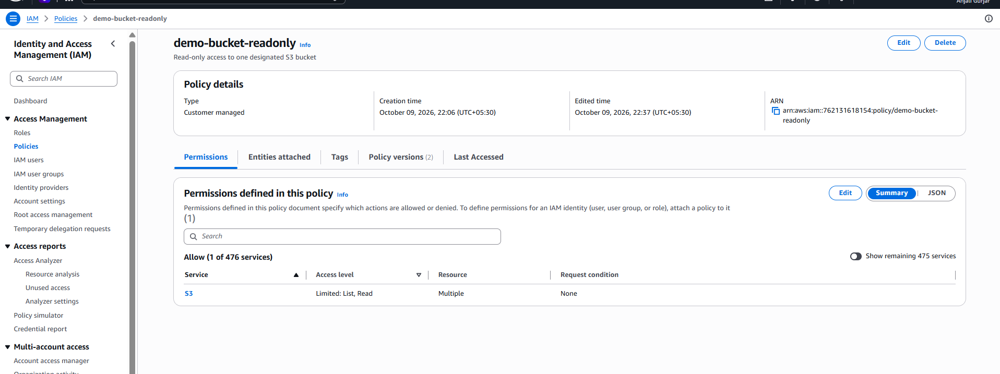
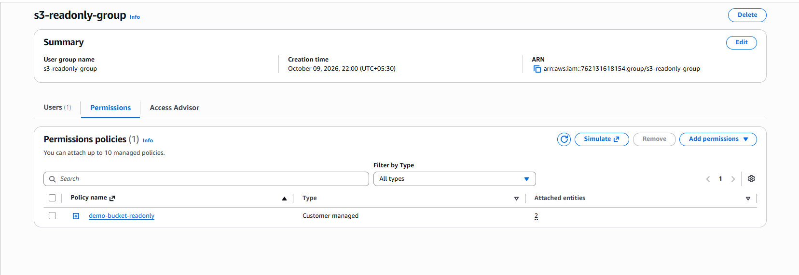
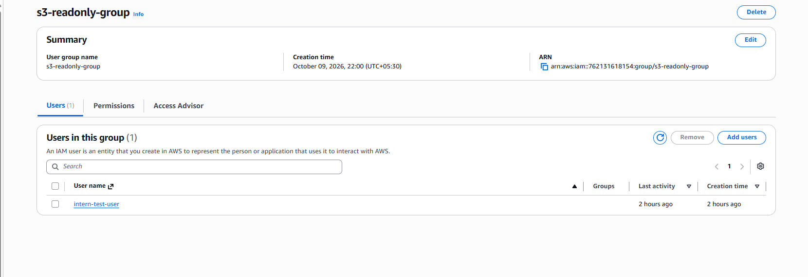
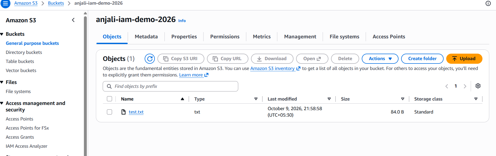
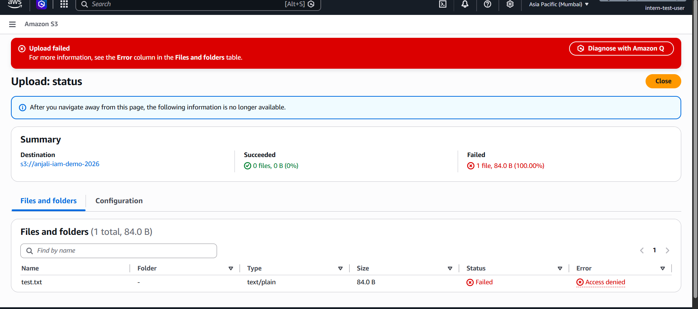
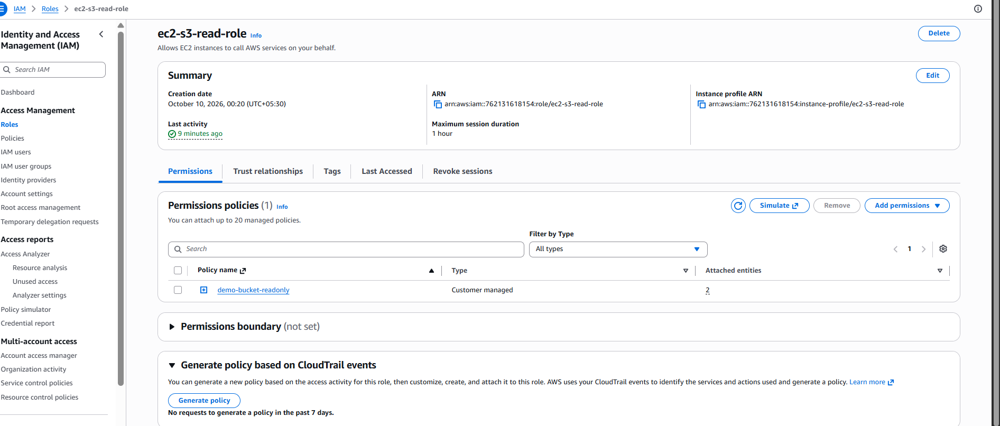
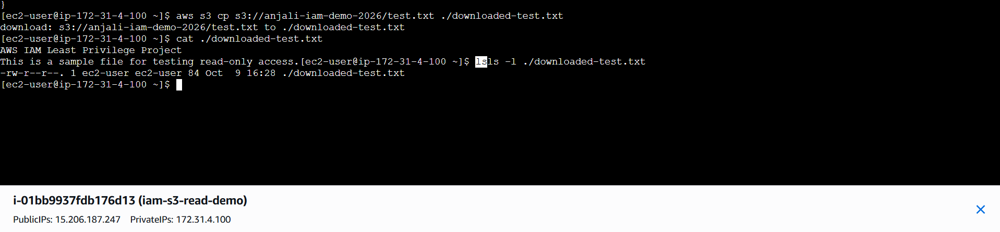
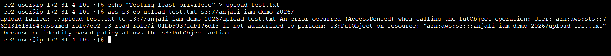

# AWS IAM Least-Privilege Access Control

A hands-on AWS security project demonstrating least-privilege access control using IAM users, groups, custom policies, Multi-Factor Authentication (MFA), Amazon S3, and EC2 IAM roles.

The project focuses on restricting access to a specific S3 bucket, validating permissions through real tests, and securely accessing AWS resources from an EC2 instance without storing long-term AWS access keys on the server.

## Project Objectives

- Create a private Amazon S3 bucket.
- Configure IAM users and groups.
- Create a custom S3 read-only policy using the AWS Management Console Visual Editor.
- Grant permissions through an IAM group instead of directly attaching the policy to the user.
- Configure MFA for the test IAM user.
- Configure an EC2 IAM role for secure S3 access.
- Verify allowed and denied operations.
- Document the implementation and validation results.

## AWS Services and Tools Used

- **AWS Identity and Access Management (IAM):** Identity and permission management.
- **Amazon Simple Storage Service (S3):** Private object storage.
- **Amazon Elastic Compute Cloud (EC2):** Compute instance used to test role-based access.
- **AWS CLI:** Command-line testing of S3 permissions and AWS identity.
- **AWS Management Console:** Visual configuration of AWS resources.
- **Git and GitHub:** Version control and project documentation.

## Architecture

### 1. Human access

`IAM User → IAM Group → Custom IAM Policy → S3 Bucket`

The test user receives read-only permissions through the `s3-readonly-group` group.

### 2. Application access

`EC2 Instance → IAM Role → Temporary Credentials → S3 Bucket`

The EC2 instance assumes the `ec2-s3-read-role` role to access the designated bucket without requiring permanent access keys stored on the instance.

## Resources Created

| Resource | Name |
|---|---|
| S3 bucket | `anjali-iam-demo-2026` |
| IAM test user | `intern-test-user` |
| IAM group | `s3-readonly-group` |
| Custom IAM policy | `demo-bucket-readonly` |
| EC2 IAM role | `ec2-s3-read-role` |
| EC2 instance | `iam-s3-read-demo` |

## Implementation Steps

### 1. Account security

- Enabled MFA on the AWS root account.
- Configured a billing budget alert.
- Used a separate administrative identity for routine configuration where possible.

### 2. S3 bucket configuration

- Created a private S3 bucket in the Mumbai region (`ap-south-1`).
- Kept S3 Block Public Access enabled.
- Uploaded a sample text file for permission testing.

### 3. IAM user and group

- Created the `intern-test-user` IAM user.
- Created the `s3-readonly-group` IAM group.
- Added the test user to the group.
- Assigned the custom read-only policy to the group.

### 4. Custom least-privilege policy

Created `demo-bucket-readonly` using the AWS IAM Visual Editor.

The policy grants the following permissions on the designated bucket:

| Permission | Purpose |
|---|---|
| `s3:ListBucket` | List objects in the specified bucket |
| `s3:GetObject` | Read or download objects in the specified bucket |

The policy does not grant `s3:PutObject` or `s3:DeleteObject`.

The bucket-level and object-level resources are configured separately because S3 uses different resource types for these actions.

### 5. MFA configuration

- Registered an authenticator-app MFA device for `intern-test-user`.
- Verified that an MFA device was assigned to the user.

### 6. EC2 role-based access

- Created the `ec2-s3-read-role` IAM role with EC2 as its trusted service.
- Attached `demo-bucket-readonly` to the role.
- Attached the role to the EC2 instance.
- Used AWS CLI commands to test S3 access.
- Verified the active AWS identity using `aws sts get-caller-identity`.

No permanent AWS access keys were configured on the EC2 instance for this test.

## Validation Results

| Test | Expected result | Result |
|---|---|---|
| EC2 lists objects in the designated bucket | Allowed | Passed |
| EC2 downloads an existing object | Allowed | Passed |
| EC2 uploads an object | Access Denied | Passed |
| EC2 identity identifies the assumed IAM role | Role identity returned | Passed |
| IAM user reads the designated bucket | Allowed | Verify against your actual test |
| IAM user uploads an object | Access Denied | Verify against your actual test |
| IAM user deletes an object | Access Denied | Verify against your actual test |
| MFA device assigned to test user | Device registered | Passed |

The EC2 upload test returned `AccessDenied` for `s3:PutObject`, confirming that the role did not have an identity-based permission allowing uploads.

## Screenshots and Evidence

### 1. Custom IAM Read-Only Policy

### 2. IAM Group Permissions

### 3. IAM User Group Membership

### 4. IAM User Read Access

### 5. IAM User Upload Denied

### 6. EC2 IAM Role

### 7. EC2 S3 Download Success

### 8. EC2 S3 Upload Denied

## Key Learnings

- IAM users, groups, policies, and roles have different responsibilities.
- The principle of least privilege limits unnecessary access.
- `s3:ListBucket` applies to the bucket, while `s3:GetObject` applies to objects.
- Permissions can be managed centrally through IAM groups.
- An `AccessDenied` error can be an expected security outcome.
- EC2 can access AWS services through an IAM role and temporary credentials.
- Permanent access keys should not be stored on EC2 instances when role-based access is appropriate.
- Permission testing is essential for validating a security configuration.

## Security Considerations

- Kept S3 Block Public Access enabled.
- Scoped the custom policy to one designated bucket.
- Avoided granting S3 upload and delete permissions.
- Used role-based authentication for EC2.
- Avoided publishing credentials, private keys, MFA QR codes, and other sensitive information.

## Future Improvements

- Enable and analyze AWS CloudTrail events for auditing.
- Use IAM Access Analyzer to identify unintended access.
- Explore IAM Identity Center for workforce access.
- Evaluate permission boundaries for delegated administration.
- Add automated permission tests.
- Improve monitoring and access reviews.

## Cleanup

After capturing the required evidence:

- Terminate the EC2 instance when it is no longer needed.
- Delete unused resources carefully.
- Empty and delete the S3 bucket only when its contents are no longer needed.
- Review billing to ensure no unwanted resources remain.

## Author

**Anjali Gurjar**

B.Tech CSE (AI & ML) student learning AWS, cloud security, and DevOps through hands-on projects.